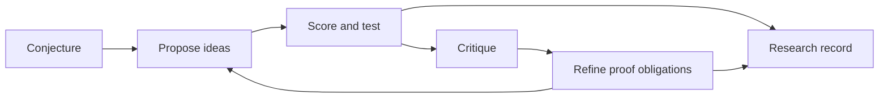

# DeepMath Agent

DeepMath is a multiagent research system for discovering and testing mathematical ideas on Cayley graphs. It turns a conjecture into a cycle of proposed arguments, computational experiments, critical review, and refined proof obligations.

Agents explore structural lemmas, search for counterexamples, and investigate geometric representations in parallel. Reasoning scores help prioritize their proposals, while exact computations and replayable witnesses establish what each experiment supports. Every session produces a research record that can be inspected, reproduced, and continued.



## Start a research session

A clone contains the pinned research source. Install the environment, then follow the [setup guide](docs/integrations.md) to configure model access and fit a reasoning scorer:

```bash
python -m pip install '.[research]'
deepmath doctor
deepmath workspace init research
```

Select a problem and launch a session:

```bash
export DEEPMATH_MODEL='your-model-id'
export OPENAI_API_KEY='your-key'
export DEEPMATH_QK_ARTIFACT='/absolute/path/to/fitted-scoring-artifact.json'

deepmath run examples/problems/lrx-n6-diameter.json \
  --config configs/research.json --workspace research --output runs/lrx-research
```

The configuration controls the number of rounds, model choices, search budget, and compute devices. Each round combines independent proposals with critique and synthesis. Results feed into the next round. The workspace retains hypotheses, findings, critiques, and open proof obligations so later sessions on the same problem can continue the investigation.

Open `report.md` in the run directory for the findings and outstanding questions. The same directory contains the full experiment record and its integrity manifest. To check, reproduce, or prepare the session for review:

```bash
deepmath verify-run runs/lrx-research
deepmath replay runs/lrx-research
deepmath export runs/lrx-research --destination exports/lrx-research
```

## Explore a conjecture

The experiment interface accepts permutation and Schreier actions, finite modular matrix groups, and the bundled graph and puzzle catalog. List constructors with `deepmath graphs` and inspect a problem's generators with `deepmath graph path/to/problem.json`. The full CayleyPy Python API is available in the same installation for custom experiments.

The included problems cover LRX and directed LX diameters, reflected witnesses, lattice-area proposals, pancake graphs, Schreier graphs, and modular matrix groups. You can run a focused experiment before starting a longer research session:

```bash
# Compute a finite diameter and its growth layers.
deepmath experiment examples/problems/lx-n6-diameter.json

# Reconstruct the reflected LRX witness.
deepmath experiment examples/problems/lrx-n8-witness.json --kind witness

# Test a proposed area bound against exact distances.
deepmath experiment examples/problems/lrx-n6-holography-probe.json \
  --kind area_probe --statistic cyclic_inversions
```

The research program draws on [CayleyPy Growth](https://arxiv.org/html/2509.19162v2) and [AI-Holography](https://arxiv.org/html/2603.22195v1). The [research notes](docs/research.md) connect their conjectures and geometric ideas to concrete experiments.

## LRX result

The LRX proof establishes a sharp diameter lower bound and an exact reflected-witness distance. For every n≥4,

\[
d((0,1,\ldots,n-1),(1,0,n-1,\ldots,2))=\binom n2,
\qquad \operatorname{diam}(LRX_n)\ge\binom n2.
\]

The [LRX result](docs/lrx-case-study.md) presents the theorem, proof reference, and constructive word. Its implementation is checked by replay for n=4…100 and by independent shortest-path computation for n=4…7. Establishing the matching upper bound for every permutation remains a research question.

## Assess the evidence

Reasoning scores guide exploration. Replayed words provide distance upper bounds; exact search establishes finite distances and, after exhaustive traversal, finite diameters. General theorems require proofs of their full statements. Each research record keeps the claim, its evidence, and unresolved obligations together.

Read the [research workflow](docs/architecture.md) for how sessions progress and the [validation record](docs/validation.md) for tested behavior and execution coverage.
